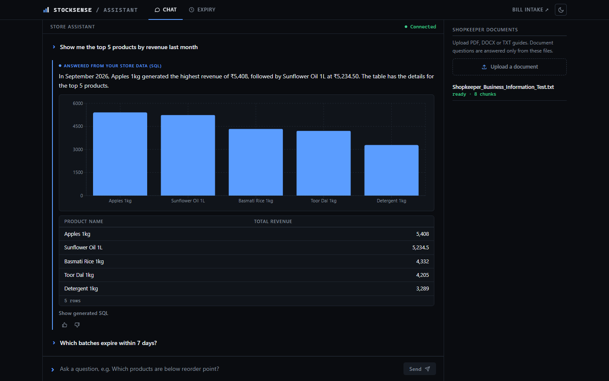
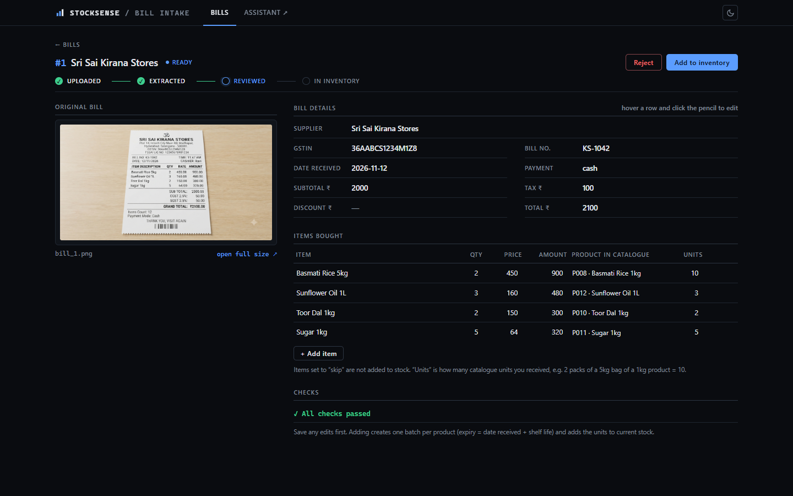
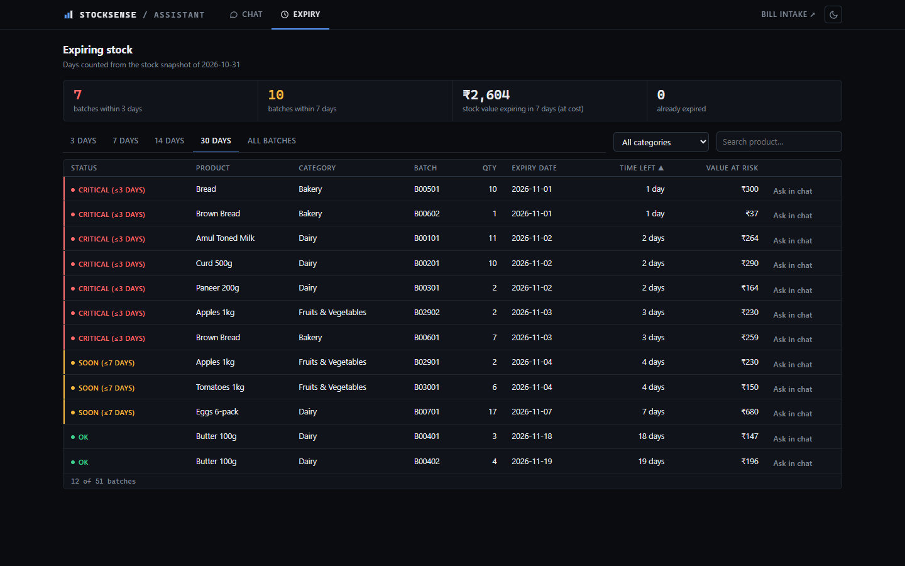
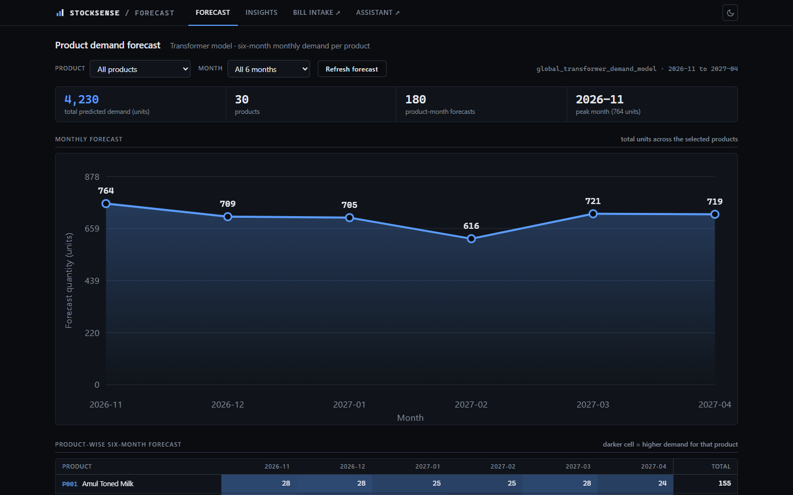
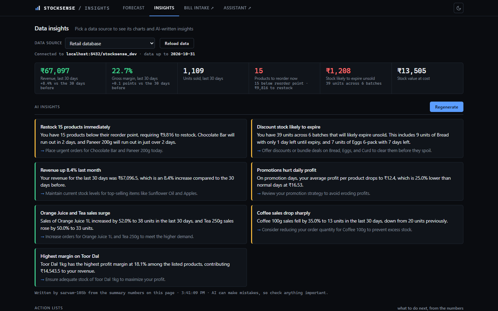

# StockSense AI

**Know what to stock before you run out.** An inventory assistant for small retailers: it reads purchase
bills, keeps stock and expiry up to date, answers questions about the shop in plain language, forecasts
demand, and writes short insights from the shop's own numbers.



---

## 1. The problem and the idea

Small shops lose money in four ways: **overstocking** locks up cash, **stockouts** lose sales, **wastage**
spoils perishables, and **orders rely on gut feel** and notebooks (see `StockSense AI Pitch Deck.pdf`).

StockSense AI closes that loop with four connected apps:

| # | App | What it does | Folder | Port |
|---|---|---|---|---|
| 1 | **Bill Intake** | Photo of a supplier bill → extracted fields → human review → stock added | `bill-extractor/` | 8000 |
| 2 | **Assistant** | Ask questions about sales, stock, expiry and suppliers (English, Hindi, Telugu); upload shop documents | `StockSense-AI_portable/StockSense-AI/` | 5173 (UI), 8001 (API) |
| 3 | **Forecast** | Six-month demand forecast per product from a Transformer model | repo root (`app.py`) | 8002 |
| 4 | **Insights** | Pick a data source, see charts and AI-written insights | repo root (`insights.py`) | 8002 `/insights` |

All four share one design (dark console theme, light/dark toggle) and link to each other from the top bar.

## 2. How it fits together

```
 Supplier bill (JPG/PNG/PDF)
        |
        v
 [1] Bill Intake ──> Sarvam Document AI (reads the bill) ──> clean + check totals ──> human review/edit
        |                                                                                   |
        | private records (bills, edits)                                  "Add to inventory"|
        v                                                                                   v
  billextractor DB (Postgres)                         retail DB: new batch + stock added (batches, inventory)
                                                                                            |
                         ┌──────────────────────────────────────────────────────────────────┤
                         v                                  v                               v
                  [2] Assistant                      [3] Forecast                    [4] Insights
          question → LLM → safe SQL →          sales history → Transformer →     fixed read-only queries →
          read-only DB → answer + chart        6-month demand per product        charts → LLM writes insights
```

**Databases (all PostgreSQL).** Keeping them separate was a deliberate choice: the team's retail tables
must stay exactly as designed (the chatbot reads them), so Bill Intake only *adds rows* to `batches` and
`inventory` and keeps its own records in a separate database.

| Database | Used by | Holds |
|---|---|---|
| Chatbot DB (embedded Postgres 16 + pgvector, `backend/.pgdata`) | Assistant | `suppliers, products, calendar, inventory, batches, sales`, plus documents, chunks, chat log |
| `stocksense_dev` (local Postgres) | Bill Intake, Insights | A copy of the retail tables built from the team's real `schema.sql` and CSVs |
| `billextractor` (local Postgres) | Bill Intake, Insights | Uploaded bills, line items, edits, original extraction |

> For the demo the chatbot DB and `stocksense_dev` are **not connected**, so stock added from a bill does
> not appear in the Assistant yet. Pointing `RETAIL_DATABASE_URL` at the chatbot's database would link them
> (see [Next steps](#9-next-steps)).

## 3. Feature tour

### 3.1 Bill Intake  (`bill-extractor/`)



1. **Upload** a purchase bill (JPG, PNG or PDF). Duplicate files are caught by file hash *before* any paid API call.
2. **Extract**: the bill goes to Sarvam Document AI with a bill schema (supplier, GSTIN, bill number, date, payment mode, subtotal, tax, discount, total, line items).
3. **Clean and check**: amounts (₹, Rs, `/-`), day-first dates, GSTIN format, payment mode; totals and line items must add up. A bill is `Ready` or `Needs review`.
4. **Match to your catalogue**: each item is matched to a product (`Basmati Rice 5kg × 2` becomes **10 units** of `Basmati Rice 1kg`). Unsure items are left for you; nothing is guessed.
5. **Review and edit**: every field has a pencil; add, change or remove items; pick the product from a dropdown. Saving re-runs the checks. Sarvam's original output is kept untouched.
6. **Add to inventory** (one confirmation): in a single transaction it creates one batch per product (expiry = date received + shelf life) and adds the units to current stock. A bill can be added only once.

Safety rules built in: only whole units; `inventory.snapshot_date` is never moved (the chatbot and expiry views measure from it); a failed add changes nothing; rejected bills never reach stock.

### 3.2 Assistant  (`StockSense-AI_portable/StockSense-AI/`)



- **Chat**: *question → router → date rules → schema builder → LLM writes SQL → SQLGlot validation → read-only database → answer*. Shows the generated SQL, a table, and an automatic chart.
- **Safe by design**: SELECT-only, table and column allow-list, forced row limit, a database role that can only read, a 5 second timeout, and numbers in the answer must appear in the query result.
- **Languages**: English, Hindi and Telugu. The reply comes back in the language of the question.
- **Documents (RAG)**: upload a PDF, DOCX or TXT; document questions are answered only from those files, with citations.
- **Expiry tab**: batches nearing expiry with critical/soon status and value at risk.

### 3.3 Forecast  (repo root, `app.py`)



A global Transformer (28-day lookback, product embedding, price, promotion, weekday and festival inputs)
forecasts the next six months for 30 products. The page shows a monthly line chart, a heat-shaded
product-by-month table, and every row. See [limitations](#8-honest-limitations-read-before-presenting).

### 3.4 Insights  (repo root, `insights.py`)



Choose a **data source** from the dropdown: *Retail database*, *Bill Intake database* or *Demand forecast data*.
You get KPI cards, **action lists**, charts, and **AI insights**. The point is things an owner can act on today:

| Source | What it tells the owner |
|---|---|
| **Retail** | **Order now** list: products that will run out before a delivery arrives, with supplier, suggested quantity and cash needed (quantity = recent daily sales x (lead time + target days of cover) minus stock, at least the minimum order). **Likely to expire unsold**: batches that will not sell before their expiry at the current sales rate (oldest batch sells first), with cost at risk. **Gross margin** and the lowest-margin products and categories. **Do promotions pay?** (extra units vs profit given up). **Busy days**: weekday vs weekend and festival lift. **Biggest risers and fallers** in units sold. Dependence on one supplier and on the top 20% of products. |
| **Bill Intake** | Total purchases and average bill, **GST paid** on purchases, purchases **on credit**, how long bills have waited to be added, supplier share of spend, and a **price check** of what you paid per unit against the cost in your catalogue (once items are matched to products). |
| **Forecast** | The 6-month forecast against the same months last year, top products, seasonality, and **which products gain or lose share of demand** (a view that stays meaningful even though the model's totals run low). |

- No SQL or passwords ever go through the page: sources are a fixed list; queries are fixed and read-only.
- Only **summary numbers** are sent to the LLM, never raw rows.
- Every number in an AI insight is **checked against the data**; ones that do not match get a *check figures* tag.
- On the forecast source a **model check** compares the first forecast month with what really sold, and shows a warning banner if they disagree (they currently do, see below).

## 4. Run it

**Prerequisites:** Python 3.11 (Bill Intake), Python 3.12 (Assistant backend), Python 3.9 to 3.11 (Forecast; TensorFlow 2.15), Node 18+, a local PostgreSQL, a Sarvam API key, and internet access (the LLM and Document AI are cloud calls).

Never commit keys. Real values live in git-ignored `.env` files; `.env.example` files hold placeholders only.

### 4.1 Bill Intake  → http://localhost:8000
```powershell
cd bill-extractor
pip install -r requirements.txt
copy .env.example .env          # then set SARVAM_API_KEY and DATABASE_URL (password) in .env
# create an empty database named billextractor once (pgAdmin: Databases > Create > Database)
python dev_retail_db.py         # builds the local retail copy 'stocksense_dev'; add the RETAIL_DATABASE_URL line it prints to .env
python -m unittest discover -s tests     # 26 tests
python app.py
```

### 4.2 Assistant  → http://localhost:5173
```powershell
cd StockSense-AI_portable\StockSense-AI\backend
pip install -r requirements.txt
# put  llm_api_key=<your Sarvam key>  in StockSense-AI_portable\StockSense-AI\.env
python -m app.db.ingest                  # starts embedded Postgres + pgvector, loads the CSVs
python scripts/verify_ingest.py          # must end with: ALL CHECKS PASSED
uvicorn app.api.main:app --port 8001

cd ..\frontend
npm install
$env:VITE_API_TARGET = "http://127.0.0.1:8001"   # omit if the backend runs on 8000
npm run dev
```
Do not re-run `python -m app.db.ingest` on a database that already has bills added: it resets `inventory` and `batches` to the CSV values.

### 4.3 Forecast + Insights  → http://127.0.0.1:8002 and /insights
```powershell
python -m venv C:\venvs\stocksense-forecast        # keep it OUTSIDE the repo (uvicorn --reload watches the repo)
C:\venvs\stocksense-forecast\Scripts\python.exe -m pip install -r requirements.txt
C:\venvs\stocksense-forecast\Scripts\python.exe -m uvicorn app:app --reload --port 8002
```
The Insights page reads `RETAIL_DATABASE_URL`, `DATABASE_URL` and `SARVAM_API_KEY` from the environment or from `bill-extractor/.env`.

**Troubleshooting (all seen while building this):**
| Symptom | Cause and fix |
|---|---|
| `No module named 'tensorflow'` | You used the normal Python. Run with the venv's Python (4.3). |
| `File not found ... accessible .keras zip file` | TensorFlow 2.16+ cannot open the model (an old HDF5 file named `.keras`). Use the pinned `tensorflow==2.15.1`. |
| Python crashes on `import onnxruntime` (Assistant tests) | `pip install onnxruntime==1.20.1`. |
| `password authentication failed` | The password in `DATABASE_URL` is wrong; URL-encode `@ : / # %` in it. |
| Forecast server ignores code edits | On Windows `--reload` can hang after the first edit; stop and start the server. |

## 5. Demo script (about 8 minutes)

1. **Problem (30 s).** Overstock, stockouts, wastage, gut feel.
2. **Bill Intake (2 min).** Upload the kirana bill → show the extracted fields beside the photo → change one value with the pencil → **Add to inventory** → show the batches created. Then upload the broken pharmacy bill to show the checks catching a bad GSTIN and totals that do not add up.
3. **Assistant (2 min).** Ask *Which products are below their reorder point?* Open *Show generated SQL*. Ask a Telugu question (below). Open the Expiry tab. Ask a document question after uploading the shop guide.
4. **Forecast (1 min).** Show the six-month chart and the product table; then be upfront about the model check banner (section 8).
5. **Insights (1.5 min).** On *Retail*: open the **Order now** list (what to buy, from whom, for how much) and **Likely to expire unsold**, then the headline findings: promotions lift units about 27% but cut profit per product-day about 25%, and weekends sell about 23% more. Switch to *Forecast* and show the warning banner. Point out the AI's *check figures* tag and that only summary numbers (never raw rows) are sent to the LLM.
6. **Close (30 s).** Honest limits and next steps.

**Demo bills** (fake, generate as images): 

| Bill | Supplier | Total | Expected |
|---|---|---|---|
| Kirana | Sri Sai Kirana Stores, GSTIN `36AABCS1234M1Z8`, 12/11/2026, cash | ₹2,100 | Ready |
| Restaurant | Spice Garden Restaurant, GSTIN `29ABCDE1234F1Z5`, 05-Nov-2026, UPI | ₹1,115.10 | Ready |
| Pharmacy (broken) | Apollo Care Pharmacy, GSTIN `33AAPFU0939F1Z` (14 chars), card | printed ₹630, items add to ₹360 | Needs review |

Each bill can be added to inventory **once**. To rehearse again, recreate the retail copy (`DROP DATABASE stocksense_dev`, then `python dev_retail_db.py`) and use fresh copies of the bill images.

**Sample questions**

| English | Telugu |
|---|---|
| Which products are below their reorder point? | ఏ ఉత్పత్తులు తక్కువ స్టాక్‌లో ఉన్నాయి? |
| What are the top 5 best-selling products in the last 30 days? | గత 30 రోజుల్లో ఎక్కువగా అమ్ముడైన 5 ఉత్పత్తులు ఏవి? |
| Which batches expire within 7 days? | ఈ వారంలో గడువు ముగిసే బ్యాచ్‌లు ఏవి? |
| How many products come from each supplier? | ప్రతి సరఫరాదారు నుండి ఎన్ని ఉత్పత్తులు వస్తున్నాయి? |

Have **internet access** and a valid key ready: bill extraction takes 10 to 60 s, the first forecast about 15 s, and an AI answer 5 to 20 s.

## 6. What was verified

| Check | Result |
|---|---|
| Bill Intake tests (cleaning, checks, matching, edit, add-to-inventory, rollback, web flow) | 26 pass |
| Assistant tests (security, schema, dates, multilingual, RAG, API) | 96 pass |
| Insights numbers (revenue, stock, expiry, rankings, bills) recomputed independently from the raw CSVs and a direct DB query | 17 of 17 match |
| New owner insights (reorder quantities, expiry waste, margins, promotions, weekday and festival lift, risers and fallers, concentration) recomputed independently with separate code | 20 of 20 match |
| Forecast reproduces the forecast CSV the team committed | 180 of 180 rows identical |
| Adding stock from a bill leaves the chatbot's views and invariants intact (batches add up to current stock; `snapshot_date` untouched) | passes; also tested live against the chatbot's own database, then undone |

## 7. Tech stack

| Layer | What is used |
|---|---|
| Backend | Python, FastAPI, Uvicorn, psycopg / psycopg2, SQLGlot (SQL safety), pgvector |
| Database | PostgreSQL (embedded Postgres 16 + pgvector for the Assistant; local Postgres for Bill Intake) |
| AI | Sarvam Document AI (bill extraction), Sarvam chat model `sarvam-105b` (SQL, answers, insights), fastembed `bge-small` embeddings (RAG), TensorFlow 2.15 Transformer (forecast) |
| Frontend | React 18 + Vite + Recharts (Assistant); server-rendered Jinja2 + plain HTML/JS (Bill Intake); plain HTML + SVG (Forecast, Insights). No UI framework or icon library. |

**Pitch deck vs what is built:** built are FastAPI, PostgreSQL, a React dashboard and a Transformer forecast.
*Not built:* Prophet, XGBoost and LSTM models, the Flutter mobile app, WhatsApp/SMS alerts, one-tap reorder
lists, Docker/cloud deployment, and weather features.

## 8. Honest limitations (read before presenting)

- **The data is synthetic.** The original sample dataset is synthetic demo data, and about **91%** of the forecast training history (2006 to 2024) was *generated* to extend it. Nothing here is a real shop's sales.
- **The forecast is biased low.** In a back-test the model was about **38% too low every month** (error 38%), while simply using the last 90 days' average was far better (16%). It does rank products correctly (correlation 0.81 against a shuffled 0.16), but it should not be trusted for totals. Its "demand drops 32.5% versus last year" is a model artefact; the Insights page warns about this itself. That back-test used a model that had already seen the test months, so real-world accuracy can only be equal or worse.
- **AI insights can still be wrong.** The number check confirms a figure exists in the data; it cannot confirm the sentence around it is correct. While testing, the AI mixed up "top 1" with "top 10", misread the status "Ready", and compared a 6-month total with a full year. These were fixed, but the page tells users to verify important claims.
- **Bill Intake treats bills as purchase bills** (stock coming in). Product matching is string-based, with no LLM, and anything unsure is left for the user.
- **The databases are not linked in the demo** (see section 2).
- **`--reload` on Windows** can stop picking up edits for the TensorFlow app after the first change.

## 9. Next steps

1. **Connect Bill Intake to the chatbot's database** (`RETAIL_DATABASE_URL`) so stock from a bill is visible to the Assistant, with a shared Postgres that has pgvector and the limited-privilege role in `bill-extractor/retail_grants.sql`.
2. **Fix the forecast bias**: train on the mean (for example a Poisson loss) instead of a median-like loss, calibrate against recent actuals, and validate on a genuinely held-out period. Then replace the synthetic history with real sales.
3. **One LLM call for product matching** (single call per bill, constrained to the product list) for names the string matcher misses.
4. **Make the ingest script safe to re-run** so it never overwrites stock added from bills.
5. Alerts (WhatsApp/SMS) and reorder lists, from the pitch deck.

## 10. Likely questions

| Question | Short answer |
|---|---|
| Is the data real? | No: synthetic demo data (section 8). The pipeline is real; only the data is simulated. |
| How accurate is the forecast? | It ranks products well but its totals are about 38% low. We measured this, show the warning, and have a fix planned. |
| Can the chatbot damage the database? | No. SQL is SELECT-only, validated, run through a read-only role with a timeout. |
| What leaves the machine? | Bill images go to Sarvam Document AI; questions and summary numbers go to the Sarvam LLM. Insights send only aggregates, not rows. |
| What if the bill is read wrongly? | Totals are cross-checked, the bill is flagged, and nothing reaches stock until a person confirms. The original extraction is kept. |
| Why separate databases? | The team's retail schema (used by the chatbot) must not change, so Bill Intake only inserts rows and keeps its own records elsewhere. |
| Which languages? | The Assistant answers in English, Hindi and Telugu; bills can be read in nine Indian languages. |

## 11. Repository layout

```
StockSense-AI/
├── README.md                     this file
├── bill-extractor/               [1] Bill Intake (FastAPI + Jinja2, psycopg)
│   ├── app.py  pipeline.py  matching.py  checks.py  cleaning.py  retail.py  db.py  sarvam_client.py  schema.py
│   ├── dev_retail_db.py  retail_schema.sql  retail_views.sql  retail_grants.sql
│   ├── templates/  static/  tests/
├── StockSense-AI_portable/StockSense-AI/    [2] Assistant
│   ├── backend/app/{nl2sql,rag,llm,db,api}/   backend/tests/
│   └── frontend/src/                          docs/DATASET.md
├── app.py  forecast_transformer.py  insights.py   [3][4] Forecast + Insights
├── static/{index.html,insights.html}
├── datasets/  models/  forecasts/  requirements.txt
├── StockSense_AI_Retail_Dataset/  (original sample CSVs)
├── docs/screenshots/
└── StockSense AI Pitch Deck.pdf   Merchant Bill Extraction Plan.docx
```
